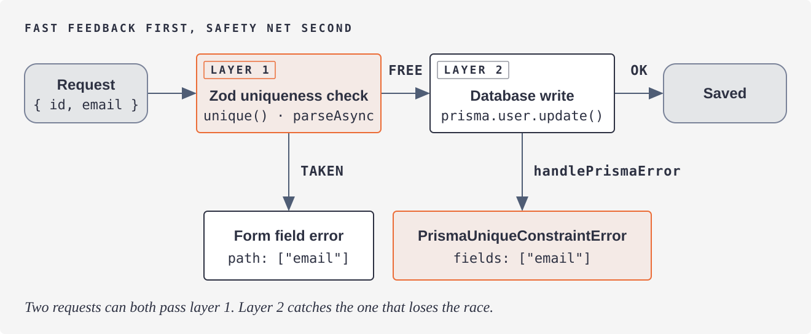

<p align="center">
  
</p>

# zod-bridge

**The async validation layer Zod lacks.** Typed Prisma errors and DB-aware uniqueness validators for Zod v4.

[](https://github.com/luis-serrano-l/zod-bridge/actions/workflows/test.yml)


| You write today | With zod-bridge |
|---|---|
| `if (e?.code === "P2002")` plus version-specific `meta` parsing | `e instanceof PrismaUniqueConstraintError`, then `e.fields` |
| A hand-rolled async `.refine()` with `findFirst` at every call site | `unique(z.email(), prismaUnique(prisma.user, "email"))` |
| An extra `NOT: { id }` clause so an update doesn't conflict with itself | Automatic when the parsed object carries the id |



## Contents

- [Quick start](#quick-start)
- [Before and after](#before-and-after)
- [API at a glance](#api-at-a-glance)
- [Uniqueness validators](#uniqueness-validators)
- [Typed Prisma errors](#typed-prisma-errors)
- [Race conditions](#race-conditions)
  - [One error branch for both layers](#one-error-branch-for-both-layers)
- [Schema bridge: createSchema](#schema-bridge-createschema)
- [Find what to replace: zod-bridge doctor](#find-what-to-replace-zod-bridge-doctor)
- [Install details](#install-details)
- [Demo](#demo)
- [AI agents](#ai-agents)

## Quick start

```bash
npm install zod-bridge
```

```ts
import { z } from "zod"
import { unique } from "zod-bridge"
import { prismaUnique, handlePrismaError, toZodIssues } from "zod-bridge/prisma"

const UserSchema = unique(
  z.object({ id: z.number().optional(), email: z.email() }),
  prismaUnique(prisma.user, "email"),
  "Email already taken",
)

try {
  const data = await UserSchema.parseAsync(input) // layer 1: field error if taken
  await prisma.user.create({ data }).catch(handlePrismaError) // layer 2: typed error if a concurrent request won
} catch (e) {
  const issues = toZodIssues(e, "Email already taken") // one shape for both layers
  if (issues) return res.status(400).json({ issues })
  // [{ code: "custom", message: "Email already taken", path: ["email"] }] either way
  throw e
}
```

> [!IMPORTANT]
> `unique()` is async. Use `parseAsync` / `safeParseAsync`; `.parse()` throws at runtime.

## Before and after

Example schema: `User` (unique `email`), `Post` (`authorId` FK), `Like` (composite unique on `userId, postId`).

### Update a user's email

<details>
<summary>Without zod-bridge</summary>

```ts
const UserSchema = z.object({ id: z.number(), email: z.email() }).superRefine(async (u, ctx) => {
  if (await prisma.user.findFirst({ where: { email: u.email, NOT: { id: u.id } } }))
    ctx.addIssue({ code: "custom", message: "Email already taken", path: ["email"] })
})

try {
  const { id, email } = await UserSchema.parseAsync({ ...input, id })
  await prisma.user.update({ where: { id }, data: { email } })
} catch (e: any) {
  if (e?.code === "P2002") {
    // Which field failed? Depends on the Prisma version:
    //   meta.driverAdapterError.cause.constraint.fields   (7 + adapter, ≤ 7.9)
    //   meta.driverAdapterError.cause.constraint.index    (7.10+, "User_email_key" — parse it)
    //   meta.target                                       (≤ 6, string | string[])
  }
  if (e?.code === "P2025") { /* not found */ }
}
```

</details>

With zod-bridge:

```ts
const UserSchema = unique(
  z.object({ id: z.number().optional(), email: z.email() }),
  prismaUnique(prisma.user, "email"),
  "Email already taken",
)

try {
  const { id, email } = await UserSchema.parseAsync({ ...input, id }) // id present → own row excluded
  await prisma.user.update({ where: { id }, data: { email } })
} catch (e) {
  handlePrismaError(e) // throws PrismaUniqueConstraintError { fields: ["email"] } or PrismaNotFoundError
}
```

### Like a post

<details>
<summary>Without zod-bridge</summary>

```ts
const LikeSchema = z.object({ userId: z.number(), postId: z.number() }).refine(
  async ({ userId, postId }) => !(await prisma.like.findFirst({ where: { userId, postId } })),
  "Already liked this post",
)

try {
  await prisma.like.create({ data: await LikeSchema.parseAsync(input) })
} catch (e: any) {
  if (e?.code === "P2002") { /* already liked */ }
  if (e?.code === "P2003") {
    // Which FK? meta.field_name on Prisma ≤ 6; on 7.10+ only the index name ships
    // ("Post_authorId_fkey") — parse the field out of it.
  }
}
```

</details>

With zod-bridge:

```ts
const LikeSchema = uniqueComposite(
  z.object({ userId: z.number(), postId: z.number() }),
  prismaUniqueComposite(prisma.like, ["userId", "postId"]),
  "Already liked this post",
)

try {
  await prisma.like.create({ data: await LikeSchema.parseAsync(input) })
} catch (e) {
  handlePrismaError(e) // throws PrismaUniqueConstraintError or PrismaForeignKeyError { fieldName: "postId" }
}
```

The version-specific parsing in the comments is what `zod-bridge/prisma` maintains for you, unit-tested
against every Prisma 5–7 error shape. The Zod check is instant form feedback; `handlePrismaError` is the
safety net for the request that loses a race (see [Race conditions](#race-conditions)).

## API at a glance

| Import | Export | What it does |
|---|---|---|
| `zod-bridge` | `unique(schema, check, message \| { message?, path?, excludeWhere? })` | Wraps a schema with an async uniqueness check |
| `zod-bridge` | `uniqueComposite(schema, check, options?)` | Same, for multi-field constraints |
| `zod-bridge/prisma` | `prismaUnique(model, field, { primaryKey? })` | Check fn for `unique()` |
| `zod-bridge/prisma` | `prismaUniqueComposite(model, fields, { primaryKey? })` | Check fn for `uniqueComposite()` |
| `zod-bridge/prisma` | `handlePrismaError(e)` | Rethrows a known Prisma error as a typed class, anything else untouched |
| `zod-bridge/prisma` | `toZodIssues(e, message \| { message?, path?, fields? })` | Zod issues for a `ZodError` or a `PrismaUniqueConstraintError` (the issue `unique()` would have produced), `undefined` for anything else |
| `zod-bridge/prisma` | `findOrThrow(() => query)` | Throws `PrismaNotFoundError` instead of returning `null` |
| `zod-bridge/prisma` | `createSchema(model, descriptor, { pick \| omit, fields?, mode?, unique? })` | Zod schema of a Prisma model with every unique check wired, plus `schema.toZodIssues(e)` |
| `zod-bridge` (Prisma generator) | `provider = "zod-bridge"` | Writes the `<Model>Model` descriptors `createSchema` reads |
| `zod-bridge` (command) | `npx zod-bridge doctor [dir] [--json]` | Lists hand-rolled Prisma error handling in a project with the replacement for each |

| Prisma code | Class | Extra property |
|---|---|---|
| `P2002` unique | `PrismaUniqueConstraintError` | `fields: string[]` |
| `P2025` not found | `PrismaNotFoundError` | |
| `P2003` foreign key | `PrismaForeignKeyError` | `fieldName: string` |
| `P2014` relation violation | `PrismaRelationViolationError` | `relationName: string` |

Every class extends `PrismaBridgeError` (one `instanceof` catches them all), has a literal `code`
and keeps the original Prisma error as `cause`.

## Uniqueness validators

The check is a wrapper, not a method, because Zod v4 has no plugin API and patching
`ZodType.prototype` breaks with a second Zod copy. It does not query the database for a value that
already failed validation (an invalid email is never looked up).

### Single-field unique

```ts
const EmailSchema = unique(
  z.email(),
  prismaUnique(prisma.user, "email"),
  "Email already taken",
)

const result = await EmailSchema.safeParseAsync(input.email)
```

### Updating a record: its own value is not a conflict

Validate the object instead of the bare field. When the parsed value carries the primary key,
`prismaUnique` excludes that record from the check (`NOT: { id }`) automatically:

```ts
const UserSchema = unique(
  z.object({ id: z.number().optional(), email: z.email() }),
  prismaUnique(prisma.user, "email"),
  "Email already taken",
)

await UserSchema.parseAsync(req.body)                                   // create: plain check
await UserSchema.parseAsync({ ...req.body, id: Number(req.params.id) }) // update: NOT: { id }
```

The issue is reported at `path: ["email"]`. The same schema serves create and update, so there
is nothing to rebuild per request.

<details>
<summary>Details: where the id comes from, other primary keys, <code>excludeWhere</code></summary>

- Take the id from the route or session and merge it in, as above. A body-supplied id is under
  the client's control; if a caller games it, the insert still fails and `handlePrismaError`
  reports it (see [Race conditions](#race-conditions)).
- The key defaults to `id`. Pass `{ primaryKey: "uuid" }` or `{ primaryKey: ["tenantId", "slug"] }`
  for other names or composite keys. Exclusion applies only when every key field is present.
  Why an option and not detection: Prisma exposes no primary-key info at runtime. The generated
  `Prisma.dmmf` carries only field names and types (its `.d.ts` declares `isId`, but it is
  `undefined`), and the `WhereUniqueInput` type lists `@id` and `@unique` fields identically.
- Wrap the object, not the field. A `unique()` on `email` inside `z.object({ id, email })` cannot
  see `id`, because a Zod refinement only sees its own value.
- Explicit escape hatch: `unique(schema, check, { excludeWhere: { ... } })` takes a full Prisma
  `where` fragment and overrides the implicit exclusion. It is typed as the model's `WhereInput`.

</details>

### Composite unique constraints

```ts
const LikeSchema = uniqueComposite(
  z.object({ userId: z.number(), postId: z.number() }),
  prismaUniqueComposite(prisma.like, ["userId", "postId"]),
  "Already liked this post",
)

const result = await LikeSchema.safeParseAsync({ userId, postId })
```

The issue is reported at the root of the object; pass `{ message, path: ["postId"] }` as the third
argument to attach it to a field. If any of the listed fields is absent or `null`, the check is
skipped (SQL unique constraints never conflict on `NULL`).

### Generic check function (without Prisma)

Both `unique` and `uniqueComposite` accept any async function that returns `true` (available) or `false` (taken):

```ts
const EmailSchema = unique(
  z.email(),
  async (val) => !(await redis.sismember("emails", val)),
  "Email already taken",
)
```

## Typed Prisma errors

```ts
try {
  await prisma.user.create({ data: { email } })
} catch (e) {
  if (e instanceof PrismaUniqueConstraintError) console.log(e.fields) // ["email"]
  if (e instanceof PrismaForeignKeyError) console.log(e.fieldName) // "authorId"
  if (e instanceof PrismaRelationViolationError) console.log(e.relationName) // "UserPost"
  if (e instanceof PrismaNotFoundError) { /* 404 */ }
}
```

`handlePrismaError(e)` does the conversion for you inside a `catch`; unknown errors are rethrown as-is.
`e.cause` is the original `PrismaClientKnownRequestError`.

```ts
// Throws PrismaNotFoundError instead of returning null
const user = await findOrThrow(() => prisma.user.findUnique({ where: { id } }))
```

### Recipe: map errors to HTTP responses once

Call `handlePrismaError` in your handlers and translate the typed errors in one place
(Express shown; the same shape works in any framework):

```ts
app.use((err, req, res, next) => {
  if (err instanceof z.ZodError) return res.status(400).json({ issues: err.issues })
  if (err instanceof PrismaUniqueConstraintError) return res.status(409).json({ fields: err.fields })
  if (err instanceof PrismaForeignKeyError) return res.status(422).json({ field: err.fieldName })
  if (err instanceof PrismaNotFoundError) return res.status(404).end()
  next(err)
})
```

## Race conditions

The check and the write are two operations with a gap between them, so two concurrent requests can
both pass the Zod check and one then fails in the database. This is by design:

| Layer | Role | Failure looks like |
|---|---|---|
| 1. `unique()` | Best-effort, instant form feedback | `ZodError` with an issue at the field |
| 2. `handlePrismaError` | Correctness, catches the request that lost the race | `PrismaUniqueConstraintError` |

Always use both, as in [Quick start](#quick-start).

### One error branch for both layers

The two layers fail with different classes for the same problem. `toZodIssues(e, options?)` turns
either into the same Zod issues, so the route has one branch and the client sees one shape:

```ts
try {
  const data = await UserSchema.parseAsync(input)
  await prisma.user.create({ data }).catch(handlePrismaError)
} catch (e) {
  const issues = toZodIssues(e, "Email already taken")
  if (issues) return res.status(400).json({ issues })
  throw e // not a validation problem: not found, foreign key, anything unknown
}
```

| `e` is | `toZodIssues(e)` returns |
|---|---|
| `ZodError` | `e.issues` in a new array |
| `PrismaUniqueConstraintError` (or a raw Prisma `P2002`) | `[{ code: "custom", message, path }]`, equal to the issue `unique()` adds |
| anything else | `undefined` |

- Pass the same options you gave the validator: a message string, or `{ message, path }`. The
  message defaults to `"Value already taken"`, like `unique()`.
- `path` defaults to `[field]` for a single-field constraint and to `[]` (the object root) for a
  composite one, the same places `prismaUnique` and `uniqueComposite` report. Set `path` for a
  nested schema (`["user", "email"]`) or to attach a composite conflict to a field.
- Without `path` the path is read from the database error. That equals the path of `unique()`
  when the validator sits in a top-level `z.object` and the column is not renamed. Pass `path`
  when the schema is nested, when you parse a bare value (`path: []`), or when the column is
  `@map`ped. A column containing `_` reports at the root on Prisma 7.10+ unless `fields` or `path`
  names it.
- `fields` limits the conversion to one constraint: a conflict on any other columns returns
  `undefined` and is rethrown, instead of reaching the client under the wrong message. Chain calls
  when a route guards several:

```ts
const issues =
  toZodIssues(e, { fields: ["email"], message: "Email already taken" }) ??
  toZodIssues(e, { fields: ["username"], message: "Username already taken" })
```

  `fields` are database column names, compared in any order with `PrismaUniqueConstraintError.fields`,
  and they also set the default path. For a `@map`ped field pass the column name in `fields` and
  the Zod key in `path`. An empty list, or an error whose fields could not be read, matches nothing.
- Every `ZodError` is returned, whichever schema threw it. Keep only the request parse and the
  write inside the `try`, so a failed parse of server-side data is not answered as a 400.
- The returned array is new, the issue objects are not: copy an issue before rewriting it.

## Schema bridge: createSchema

`createSchema` builds the Zod schema of a model from your Prisma schema and wires both layers for
you: a uniqueness check for every `@unique` / `@@unique`, the model's real primary key for update
exclusion, and one function that turns a lost race into the same issue.

Prisma does not expose field types or primary keys at runtime, so the facts come from a generator.
Add it to `schema.prisma` and run `prisma generate`:

```prisma
generator zodBridge {
  provider = "zod-bridge"
  output   = "./generated/zod-bridge.ts" // default, relative to the schema
}
```

It writes one descriptor per model (`UserModel`, `PostModel`, ...). Pass it next to the delegate:

```ts
import { z } from "zod"
import { createSchema, handlePrismaError } from "zod-bridge/prisma"
import { UserModel } from "./prisma/generated/zod-bridge"

const UserSchema = createSchema(prisma.user, UserModel, {
  pick: ["email", "name"],                 // required: the columns the client may send
  fields: { email: z.email() },            // override or add fields
  unique: [{ fields: ["email"], message: "Email already taken" }],
})

try {
  const data = await UserSchema.parseAsync(req.body)   // parseAsync, never parse
  await prisma.user.create({ data }).catch(handlePrismaError)
} catch (e) {
  const issues = UserSchema.toZodIssues(e)   // pre-check or lost race: the same issue
  if (issues) return res.status(400).json({ issues })
  throw e
}
```

Partial update: `mode: "update"` makes the primary key required and every other field optional.
Merge the route id in before parsing; the record then excludes itself from the checks.

```ts
const UserPatch = createSchema(prisma.user, UserModel, {
  mode: "update",
  pick: ["id", "email", "name"],
})

const { id, ...data } = await UserPatch.parseAsync({ ...req.body, id: Number(req.params.id) })
await prisma.user.update({ where: { id }, data }).catch(handlePrismaError)
```

- **`pick` or `omit` is required**, so no schema accepts every column by accident. `pick` is an
  allow-list: a column added to the model later (`isAdmin`) stays out until you list it. Prefer
  it for request bodies. `omit` is a deny-list (`omit: ["role", "createdAt"]`) and exposes new
  columns until you add them; `omit: []` says "every column" on purpose. Select here: Zod refuses
  `.pick()` / `.omit()` on a schema with refinements, and `toZodIssues` exists only on the schema
  `createSchema` returns.
- **The generated shape is the create input**: required columns are required, columns with a
  default (`@default`, `@updatedAt`) are optional, nullable columns accept `null`, relations are
  left out. `Int` → `z.int()`, `Decimal` → number or string, `Json` → `z.json()`, enums →
  `z.enum([...])`. Override with `fields` where your API differs (`z.email()`).
- **`DateTime` accepts what Prisma accepts**: a `Date`, or an ISO 8601 string with `Z` or an
  offset (`"2026-11-18T12:00:00+02:00"`), which is what a JSON body carries. The parsed value is
  always a `Date`. A string without a time zone, a date-only string, a number and `null` are
  rejected, as Prisma rejects them for a timestamp column. A `@db.Date` column gets the same
  schema: override the field if your API sends `"2026-11-18"`.
- **`unique` sets the message and path per constraint**, fields as arrays in any order. A
  constraint you do not list uses the defaults (`"Value already taken"`, at `[field]`, or the
  object root for a composite). A rule that matches no constraint of the schema throws when the
  schema is built.
- **`schema.toZodIssues(e)`** is [`toZodIssues`](#one-error-branch-for-both-layers) with this
  schema's constraints, messages, paths and `@map`ped column names filled in. A conflict on a
  constraint the schema does not validate (an omitted column) returns `undefined`: rethrow it.
- A constraint with a custom database name (`@@unique(map: "...")`) is still pre-checked, but on
  Prisma 7.10+ its lost-race error cannot be matched and is rethrown.
- With `exactOptionalPropertyTypes`, an optional field you pass on to Prisma (`id?: number |
  undefined`) does not typecheck; `omit` it or destructure it out.
- Rerun `prisma generate` after editing the Prisma schema. Options of the generator block:
  `output` (a `.ts` file) and `importPath` (default `"zod-bridge/prisma"`).

## Find what to replace: zod-bridge doctor

`doctor` scans a project for the code this library replaces and prints where it is:

```bash
npx zod-bridge doctor          # the current directory
npx zod-bridge doctor src      # one directory (or one file)
npx zod-bridge doctor --json   # for scripts and AI agents
```

```
src/routes/users.ts:12:22  P2002  if (err.code === "P2002") {
  → handlePrismaError(e) rethrows it as PrismaUniqueConstraintError (fields: string[]); toZodIssues(e) turns it into a Zod issue; unique(schema, prismaUnique(model, field)) reports the conflict before the write.

src/routes/users.ts:13:49  meta.target  return { status: 409, body: { fields: err.meta?.target ?? [] } }
  → read PrismaUniqueConstraintError.fields after handlePrismaError(e): meta.target is missing on Prisma 7 with a driver adapter.

2 findings in 1 file (14 scanned). ...
```

- It looks for the quoted codes `"P2002"`, `"P2003"`, `"P2025"` and `"P2014"` (comparisons, `switch`
  cases, lists) and for reads of `meta.target` and `meta.field_name`, in `.ts`, `.tsx`, `.js`,
  `.jsx`, `.mts`, `.cts`, `.mjs` and `.cjs` files.
- `node_modules`, `dist`, `coverage`, dot-directories, symlinks and `.d.ts` files are skipped, and
  so are `build` and `out` next to a `package.json` (a `src/build/` is scanned). Whole-line
  comments are skipped. A file passed instead of a directory is scanned whatever its extension.
- It is read-only and always exits 0: it is a report, not a CI gate.
- `--json` prints `{ root, filesScanned, findings, errors }`. Each finding is
  `{ file, line, column, rule, source, replacement }`, with `file` relative to the working directory.
  With `--json`, stdout is always that object: an unreadable path or a mistyped option is in `errors`.
- The match is textual: a hit is a place to look at, not a proven bug.

## Install details

Peer dependencies: `zod ^4.0.0`, `@prisma/client ^5–7` (optional, only needed for the `/prisma` import). Requires Node ≥ 22.12. ESM only.

| Import | Contents | Depends on |
|--------|----------|------------|
| `zod-bridge` | `unique()`, `uniqueComposite()`, ORM-agnostic | `zod` only |
| `zod-bridge/prisma` | Typed error classes, `handlePrismaError`, `findOrThrow`, `prismaUnique*`, `createSchema` | `zod` + `@prisma/client` |
| `zod-bridge` binary | Prisma generator for `createSchema` (`provider = "zod-bridge"`), and `zod-bridge doctor` | nothing: neither `zod` nor `@prisma/client` is loaded |

The root export has no database dependency, so the validators work with any ORM or a raw query.
Prisma is the only adapter today; others (e.g. Drizzle) can be added as `zod-bridge/<adapter>`.

<details>
<summary>Prisma 7 setup (driver adapter)</summary>

Prisma 7 requires a [driver adapter](https://www.prisma.io/docs/orm/overview/databases/database-drivers) instead of a connection URL in the schema. Install the pg adapter and pass it to `PrismaClient`:

```bash
npm install @prisma/adapter-pg pg
```

```ts
import { PrismaPg } from "@prisma/adapter-pg"
import { PrismaClient } from "@prisma/client"

const prisma = new PrismaClient({
  adapter: new PrismaPg(process.env.DATABASE_URL),
})
```

Prisma 5/6 users: no changes needed — `new PrismaClient()` works as before.

</details>

## Demo

A dockerized example that installs `zod-bridge` from a freshly packed tarball and runs every feature against a real Postgres. Requires Docker only:

```bash
cd examples/demo
docker compose up --build --abort-on-container-exit
```

Source: [`examples/demo/main.ts`](examples/demo/main.ts).

## AI agents

<details>
<summary>Why this helps when an agent writes your Prisma + Zod code</summary>

If an AI coding agent writes your Prisma + Zod code, `zod-bridge` pays off twice.

**Less code to generate.** Without it, every call site needs the same hand-written boilerplate: check `e.code === "P2002"`, parse `meta.target`, fall back to `meta.constraint.index` on Prisma 7.10+ (which no longer ships a field list), and hand-roll an async `.refine()` with a `findFirst` plus an exclusion clause for updates. With it, that collapses to `instanceof PrismaUniqueConstraintError` and one `unique()` call.

**Fewer wrong-first-try generations.** Agents burn most of their tokens on retry loops, not on the initial write. Prisma's error shape has gotchas an agent won't know about a given project — driver-adapter errors carrying only the index name, composite primary keys, excluding the record being edited on update. Each one is a failing test, a re-read, and a rewrite. `handlePrismaError` and `prismaUnique` encode that knowledge once, so the agent gets it right on the first pass.

To find the call sites in an existing project, run `npx zod-bridge doctor --json`
(see [zod-bridge doctor](#find-what-to-replace-zod-bridge-doctor)).

Two things an agent should be told at the call site:

- `unique()` / `uniqueComposite()` require `parseAsync` — `.parse()` throws at runtime.
- The Zod check is best-effort; always pair it with `handlePrismaError` for the race-condition slip-through (see [Race conditions](#race-conditions)).

</details>

## Project

[Changelog](CHANGELOG.md) · [Contributing](CONTRIBUTING.md) · [Security policy](SECURITY.md) · [Design decisions](DECISIONS.md) · [Roadmap](ROADMAP.md)

## License

MIT
