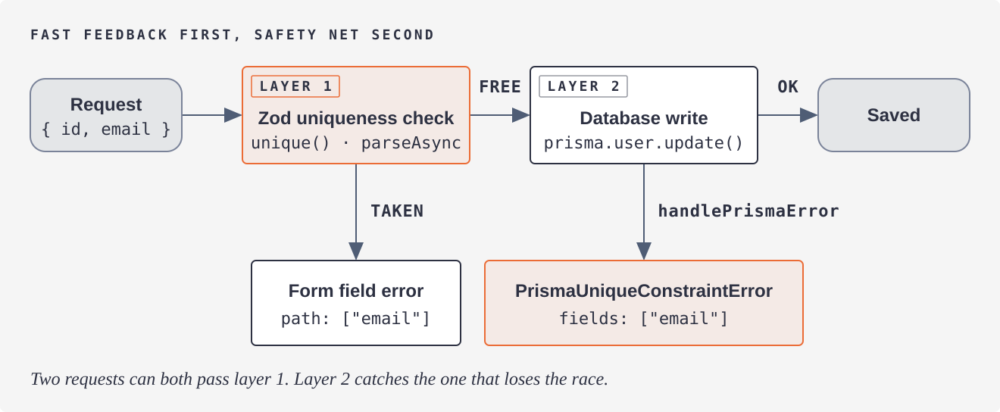

# zod-bridge

**The async validation layer Zod lacks.** Typed Prisma errors and DB-aware uniqueness validators for Zod v4.

[](https://github.com/luis-serrano-l/zod-bridge/actions/workflows/test.yml)


| You write today | With zod-bridge |
|---|---|
| `if (e?.code === "P2002")` plus version-specific `meta` parsing | `e instanceof PrismaUniqueConstraintError`, then `e.fields` |
| A hand-rolled async `.refine()` with `findFirst` at every call site | `unique(z.email(), prismaUnique(prisma.user, "email"))` |
| An extra `NOT: { id }` clause so an update doesn't conflict with itself | Automatic when the parsed object carries the id |



## Contents

- [Quick start](#quick-start)
- [Before and after](#before-and-after)
- [API at a glance](#api-at-a-glance)
- [Uniqueness validators](#uniqueness-validators)
- [Typed Prisma errors](#typed-prisma-errors)
- [Race conditions](#race-conditions)
- [Install details](#install-details)
- [Demo](#demo)
- [AI agents](#ai-agents)

## Quick start

```bash
npm install zod-bridge
```

```ts
import { z } from "zod"
import { unique } from "zod-bridge"
import { prismaUnique, handlePrismaError } from "zod-bridge/prisma"

const UserSchema = unique(
  z.object({ id: z.number().optional(), email: z.email() }),
  prismaUnique(prisma.user, "email"),
  "Email already taken",
)

try {
  const data = await UserSchema.parseAsync(input) // layer 1: field error if taken
  await prisma.user.create({ data })
} catch (e) {
  if (e instanceof z.ZodError) throw e
  handlePrismaError(e) // layer 2: typed error if a concurrent request won
}
```

> [!IMPORTANT]
> `unique()` is async. Use `parseAsync` / `safeParseAsync`; `.parse()` throws at runtime.

## Before and after

Example schema: `User` (unique `email`), `Post` (`authorId` FK), `Like` (composite unique on `userId, postId`).

### Update a user's email

<details>
<summary>Without zod-bridge</summary>

```ts
const UserSchema = z.object({ id: z.number(), email: z.email() }).superRefine(async (u, ctx) => {
  if (await prisma.user.findFirst({ where: { email: u.email, NOT: { id: u.id } } }))
    ctx.addIssue({ code: "custom", message: "Email already taken", path: ["email"] })
})

try {
  const { id, email } = await UserSchema.parseAsync({ ...input, id })
  await prisma.user.update({ where: { id }, data: { email } })
} catch (e: any) {
  if (e?.code === "P2002") {
    // Which field failed? Depends on the Prisma version:
    //   meta.driverAdapterError.cause.constraint.fields   (7 + adapter, ≤ 7.9)
    //   meta.driverAdapterError.cause.constraint.index    (7.10+, "User_email_key" — parse it)
    //   meta.target                                       (≤ 6, string | string[])
  }
  if (e?.code === "P2025") { /* not found */ }
}
```

</details>

With zod-bridge:

```ts
const UserSchema = unique(
  z.object({ id: z.number().optional(), email: z.email() }),
  prismaUnique(prisma.user, "email"),
  "Email already taken",
)

try {
  const { id, email } = await UserSchema.parseAsync({ ...input, id }) // id present → own row excluded
  await prisma.user.update({ where: { id }, data: { email } })
} catch (e) {
  handlePrismaError(e) // throws PrismaUniqueConstraintError { fields: ["email"] } or PrismaNotFoundError
}
```

### Like a post

<details>
<summary>Without zod-bridge</summary>

```ts
const LikeSchema = z.object({ userId: z.number(), postId: z.number() }).refine(
  async ({ userId, postId }) => !(await prisma.like.findFirst({ where: { userId, postId } })),
  "Already liked this post",
)

try {
  await prisma.like.create({ data: await LikeSchema.parseAsync(input) })
} catch (e: any) {
  if (e?.code === "P2002") { /* already liked */ }
  if (e?.code === "P2003") {
    // Which FK? meta.field_name on Prisma ≤ 6; on 7.10+ only the index name ships
    // ("Post_authorId_fkey") — parse the field out of it.
  }
}
```

</details>

With zod-bridge:

```ts
const LikeSchema = uniqueComposite(
  z.object({ userId: z.number(), postId: z.number() }),
  prismaUniqueComposite(prisma.like, ["userId", "postId"]),
  "Already liked this post",
)

try {
  await prisma.like.create({ data: await LikeSchema.parseAsync(input) })
} catch (e) {
  handlePrismaError(e) // throws PrismaUniqueConstraintError or PrismaForeignKeyError { fieldName: "postId" }
}
```

The version-specific parsing in the comments is what `zod-bridge/prisma` maintains for you, unit-tested
against every Prisma 5–7 error shape. The Zod check is instant form feedback; `handlePrismaError` is the
safety net for the request that loses a race (see [Race conditions](#race-conditions)).

## API at a glance

| Import | Export | What it does |
|---|---|---|
| `zod-bridge` | `unique(schema, check, options?)` | Wraps a schema with an async uniqueness check |
| `zod-bridge` | `uniqueComposite(schema, check, options?)` | Same, for multi-field constraints |
| `zod-bridge/prisma` | `prismaUnique(model, field, { primaryKey? })` | Check fn for `unique()` |
| `zod-bridge/prisma` | `prismaUniqueComposite(model, fields, { primaryKey? })` | Check fn for `uniqueComposite()` |
| `zod-bridge/prisma` | `handlePrismaError(e)` | Rethrows a known Prisma error as a typed class, anything else untouched |
| `zod-bridge/prisma` | `findOrThrow(() => query)` | Throws `PrismaNotFoundError` instead of returning `null` |

| Prisma code | Class | Extra property |
|---|---|---|
| `P2002` unique | `PrismaUniqueConstraintError` | `fields: string[]` |
| `P2025` not found | `PrismaNotFoundError` | |
| `P2003` foreign key | `PrismaForeignKeyError` | `fieldName: string` |
| `P2014` relation violation | `PrismaRelationViolationError` | `relationName: string` |

Every class has a literal `code` and keeps the original Prisma error as `cause`.

## Uniqueness validators

The check is a wrapper, not a method, because Zod v4 has no plugin API and patching
`ZodType.prototype` breaks with a second Zod copy. It does not query the database for a value that
already failed validation (an invalid email is never looked up).

### Single-field unique

```ts
const EmailSchema = unique(
  z.email(),
  prismaUnique(prisma.user, "email"),
  "Email already taken",
)

const result = await EmailSchema.safeParseAsync(input.email)
```

### Updating a record: its own value is not a conflict

Validate the object instead of the bare field. When the parsed value carries the primary key,
`prismaUnique` excludes that record from the check (`NOT: { id }`) automatically:

```ts
const UserSchema = unique(
  z.object({ id: z.number().optional(), email: z.email() }),
  prismaUnique(prisma.user, "email"),
  "Email already taken",
)

await UserSchema.parseAsync(req.body)                                   // create: plain check
await UserSchema.parseAsync({ ...req.body, id: Number(req.params.id) }) // update: NOT: { id }
```

The issue is reported at `path: ["email"]`. The same schema serves create and update, so there
is nothing to rebuild per request.

<details>
<summary>Details: where the id comes from, other primary keys, <code>excludeWhere</code></summary>

- Take the id from the route or session and merge it in, as above. A body-supplied id is under
  the client's control; if a caller games it, the insert still fails and `handlePrismaError`
  reports it (see [Race conditions](#race-conditions)).
- The key defaults to `id`. Pass `{ primaryKey: "uuid" }` or `{ primaryKey: ["tenantId", "slug"] }`
  for other names or composite keys. Exclusion applies only when every key field is present.
  Why an option and not detection: Prisma exposes no primary-key info at runtime. The generated
  `Prisma.dmmf` carries only field names and types (its `.d.ts` declares `isId`, but it is
  `undefined`), and the `WhereUniqueInput` type lists `@id` and `@unique` fields identically.
- Wrap the object, not the field. A `unique()` on `email` inside `z.object({ id, email })` cannot
  see `id`, because a Zod refinement only sees its own value.
- Explicit escape hatch: `unique(schema, check, { excludeWhere: { ... } })` takes a full Prisma
  `where` fragment and overrides the implicit exclusion. It is typed as the model's `WhereInput`.

</details>

### Composite unique constraints

```ts
const LikeSchema = uniqueComposite(
  z.object({ userId: z.number(), postId: z.number() }),
  prismaUniqueComposite(prisma.like, ["userId", "postId"]),
  "Already liked this post",
)

const result = await LikeSchema.safeParseAsync({ userId, postId })
```

If any of the listed fields is absent from the parsed value, the check is skipped.

### Generic check function (without Prisma)

Both `unique` and `uniqueComposite` accept any async function that returns `true` (available) or `false` (taken):

```ts
const EmailSchema = unique(
  z.email(),
  async (val) => !(await redis.sismember("emails", val)),
  "Email already taken",
)
```

## Typed Prisma errors

```ts
try {
  await prisma.user.create({ data: { email } })
} catch (e) {
  if (e instanceof PrismaUniqueConstraintError) console.log(e.fields) // ["email"]
  if (e instanceof PrismaForeignKeyError) console.log(e.fieldName) // "authorId"
  if (e instanceof PrismaRelationViolationError) console.log(e.relationName) // "UserPost"
  if (e instanceof PrismaNotFoundError) { /* 404 */ }
}
```

`handlePrismaError(e)` does the conversion for you inside a `catch`; unknown errors are rethrown as-is.
`e.cause` is the original `PrismaClientKnownRequestError`.

```ts
// Throws PrismaNotFoundError instead of returning null
const user = await findOrThrow(() => prisma.user.findUnique({ where: { id } }))
```

## Race conditions

The check and the write are two operations with a gap between them, so two concurrent requests can
both pass the Zod check and one then fails in the database. This is by design:

| Layer | Role | Failure looks like |
|---|---|---|
| 1. `unique()` | Best-effort, instant form feedback | `ZodError` with an issue at the field |
| 2. `handlePrismaError` | Correctness, catches the request that lost the race | `PrismaUniqueConstraintError` |

Always use both, as in [Quick start](#quick-start).

## Install details

Peer dependencies: `zod ^4.0.0`, `@prisma/client ^5–7` (optional, only needed for the `/prisma` import). Requires Node ≥ 22.12. ESM only.

| Import | Contents | Depends on |
|--------|----------|------------|
| `zod-bridge` | `unique()`, `uniqueComposite()`, ORM-agnostic | `zod` only |
| `zod-bridge/prisma` | Typed error classes, `handlePrismaError`, `findOrThrow`, `prismaUnique*` | `zod` + `@prisma/client` |

The root export has no database dependency, so the validators work with any ORM or a raw query.
Prisma is the only adapter today; others (e.g. Drizzle) can be added as `zod-bridge/<adapter>`.

<details>
<summary>Prisma 7 setup (driver adapter)</summary>

Prisma 7 requires a [driver adapter](https://www.prisma.io/docs/orm/overview/databases/database-drivers) instead of a connection URL in the schema. Install the pg adapter and pass it to `PrismaClient`:

```bash
npm install @prisma/adapter-pg pg
```

```ts
import { PrismaPg } from "@prisma/adapter-pg"
import { PrismaClient } from "@prisma/client"

const prisma = new PrismaClient({
  adapter: new PrismaPg(process.env.DATABASE_URL),
})
```

Prisma 5/6 users: no changes needed — `new PrismaClient()` works as before.

</details>

## Demo

A dockerized example that installs `zod-bridge` from a freshly packed tarball and runs every feature against a real Postgres. Requires Docker only:

```bash
cd examples/demo
docker compose up --build --abort-on-container-exit
```

Source: [`examples/demo/main.ts`](examples/demo/main.ts).

## AI agents

<details>
<summary>Why this helps when an agent writes your Prisma + Zod code</summary>

If an AI coding agent writes your Prisma + Zod code, `zod-bridge` pays off twice.

**Less code to generate.** Without it, every call site needs the same hand-written boilerplate: check `e.code === "P2002"`, parse `meta.target`, fall back to `meta.constraint.index` on Prisma 7.10+ (which no longer ships a field list), and hand-roll an async `.refine()` with a `findFirst` plus an exclusion clause for updates. With it, that collapses to `instanceof PrismaUniqueConstraintError` and one `unique()` call.

**Fewer wrong-first-try generations.** Agents burn most of their tokens on retry loops, not on the initial write. Prisma's error shape has gotchas an agent won't know about a given project — driver-adapter errors carrying only the index name, composite primary keys, excluding the record being edited on update. Each one is a failing test, a re-read, and a rewrite. `handlePrismaError` and `prismaUnique` encode that knowledge once, so the agent gets it right on the first pass.

Two things an agent should be told at the call site:

- `unique()` / `uniqueComposite()` require `parseAsync` — `.parse()` throws at runtime.
- The Zod check is best-effort; always pair it with `handlePrismaError` for the race-condition slip-through (see [Race conditions](#race-conditions)).

</details>

## License

MIT
